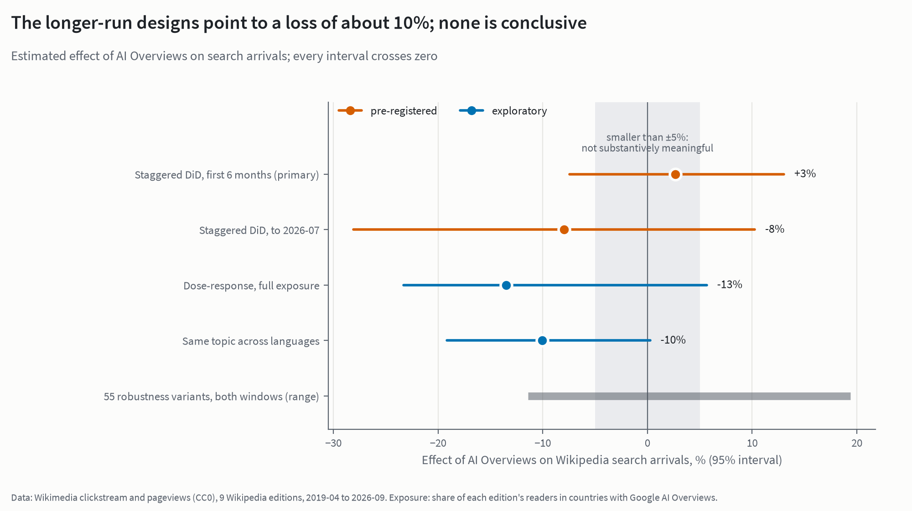

# Did Google's AI Overviews take Wikipedia's search traffic?

**Search traffic to Wikipedia fell in almost every language edition studied, but none of the fall can be pinned on Google's AI Overviews.** Google rolled AI Overviews out country by country between 2024 and 2026, so Wikipedia's language editions got it at different times. Comparing them gives an effect of +2.7% in the first six months (95% interval −7% to +13%) and −8.0% to July 2026 (−28% to +10%). Neither is distinguishable from zero. The analysis uses Wikimedia's public clickstream and pageview data for 11 language editions and was pre-registered before any post-launch comparison was made.

<picture>
  <source media="(prefers-color-scheme: dark)" srcset="report/figures/hero_estimates_dark.png">
  
</picture>

## Findings

- **Search fell almost everywhere, including where AI Overviews never launched.** Indexed to the year before AI Overviews (= 100), search arrivals in the latest 12 months were between 56 and 96 in the eight editions that got it, and 66 in Russian, which never did. Most of the largest falls (Spanish, Portuguese, Russian) are in all traffic, not search alone.
- **No loss can be attributed to AI Overviews, but a small one can't be ruled out.** The staggered comparison gives +2.7% (−7% to +13%) in the first six months and −8.0% (−28% to +10%) to July 2026. The second rests on French alone as the comparison and overlaps Wikimedia's 2025 bot-reclassification break. The design can reliably detect a loss of about 10%. English alone comes out at −6%, close to the 5% that [Khosravi & Yoganarasimhan](https://arxiv.org/abs/2602.18455) estimate for English against German and French. None of the 55 robustness variants shows a significant loss.
- **The predicted losers didn't lose more.** Quick-answer pages lost more views than long reads (−22% vs −18%), but they did so even where AI Overviews hardly reached (−26% vs −20%). The pre-registered test gives +0.5% per standard deviation (−3.4% to +4.3%). Mobile readers, the long tail (which did 15% *better*, if anything), the referral mix and editors show no effect either. None of H2–H6 survives the multiple-testing correction; the smallest p-value is 0.42.

**What this doesn't show:** that AI Overviews had no effect. A loss below about 10% is within what these data allow. Lost clicks are not harmed readers either: someone who gets a correct answer from a summary may be no worse off.

## Read more

| | |
|---|---|
| **Article** | [johnpospisil.github.io/wikipedia-ai-overviews](https://johnpospisil.github.io/wikipedia-ai-overviews/): the full write-up, with methods, robustness and limits. Source: [report/index.qmd](report/index.qmd). |
| **Dataset** | [huggingface.co/datasets/audiofreak7/wikipedia-ai-overviews-panels-2026-09](https://huggingface.co/datasets/audiofreak7/wikipedia-ai-overviews-panels-2026-09): edition × month and article × month panels plus the exposure measure (CC0; StatCounter-derived columns CC BY-SA 3.0), built with `make release`. Data card: [docs/dataset-card.md](docs/dataset-card.md). |
| **Pre-registration** | [PREREGISTRATION.md](PREREGISTRATION.md): hypotheses and decision rules locked at tag `prereg-v1`, with every later change logged and dated. |
| **Validation** | [report/validation.md](report/validation.md): an independent-reviewer pass, listing the issues found and how each was handled. |
| **Data sources** | [DATA.md](DATA.md): every source, its licence, coverage and known methodology changes. The AI Overviews rollout dates, with a source for each, are in [data/reference/aio_rollout.csv](data/reference/aio_rollout.csv). |

Pre-registered scorecard: **H1** (search arrivals fall when AI Overviews arrives) inconclusive. **H2–H6** (quick-answer pages, mobile, long tail, referral mix, editors) not supported after Holm's correction. Details are in the article.

## Reproduce

Needs Python 3.12 and [uv](https://docs.astral.sh/uv/). [Quarto](https://quarto.org) is needed only for the article.

```bash
uv sync
make all SAMPLE=1   # whole pipeline on a synthetic dump with a planted effect, about 2 minutes (what CI runs)
make test
```

The real analysis streams Wikimedia's public dumps (clickstream, `pageview_complete`, stub revision histories) and calls its APIs politely, with a cache and a descriptive User-Agent:

```bash
export WAO_RAW_DIR=/path/to/raw      # downloaded dumps, about 1 TB
export WAO_DATA_DIR=/path/to/work    # Parquet and DuckDB, about 135 GB
export WAO_CONTACT=you@example.org   # sent in the User-Agent, as Wikimedia's API policy asks
make all                             # every downloader is resumable; the first run takes days
make models figures report           # from the processed panels, about an hour
```

Seeds are fixed and randomization inference is exact, so reruns give identical results. `tests/test_headline.py` pins the headline estimates.

## Licence and attribution

Code: MIT ([LICENSE](LICENSE)). Data: Wikimedia pageview, clickstream and editor data are CC0, and so are the panels derived from them. The exposure measure uses StatCounter Global Stats search-engine shares (CC BY-SA 3.0), so the columns built from it are CC BY-SA 3.0 ([details](docs/dataset-card.md#licence-and-attribution)). No article text is published. This is an independent analysis, not affiliated with or endorsed by the Wikimedia Foundation or Google.

Sister project: [What happened to Stack Overflow?](https://github.com/johnpospisil/stackoverflow-decline)

By John Pospisil.
