```{python}
#| include: false
from wao.article import numbers

N = numbers()
```

::: {.callout-note appearance="simple" icon=false}
## In short

- **Search traffic to Wikipedia fell in almost every language edition studied.** Indexed to the year before AI Overviews (= 100), search arrivals in the latest 12 months were between `{python} N["idx_tr_min"]` and `{python} N["idx_tr_max"]` in the eight editions where Google's AI Overviews arrived, and `{python} N["idx_ru"]` in Russian, where it never launched.
- **Comparing editions by when AI Overviews reached their readers, no loss can be attributed to it.** The pre-registered estimate is `{python} N["att_primary_1"]` in the first six months (95% interval `{python} N["att_primary_ci"]`) and `{python} N["att_full_1"]` over the whole period to July 2026 (`{python} N["att_full_ci"]`). The design can reliably detect a loss of about `{python} N["mde_primary"]` or more. A smaller loss, such as the 5% another study found for English, fits these data but can't be confirmed by them.
- **None of the pre-registered "who lost" predictions holds up.** Quick-answer pages, mobile readers, the long tail of rarely read articles, how readers move between articles, and editors: none shows an AI Overviews effect after correcting for multiple tests.
:::

::: {.column-page-inset-right}
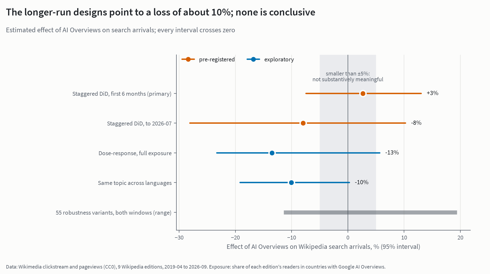{.light-content fig-alt="Dot-and-interval chart of five estimates of the effect of AI Overviews on Wikipedia search arrivals. The primary staggered difference-in-differences estimate for the first six months is +3% (−7% to +13%). Over the full window it is −8% (−28% to +10%). An exploratory dose–response estimate is −13% and a same-topic-across-languages estimate is −10%. The range of 55 robustness variants runs from −11% to +19%. Every interval crosses zero."}
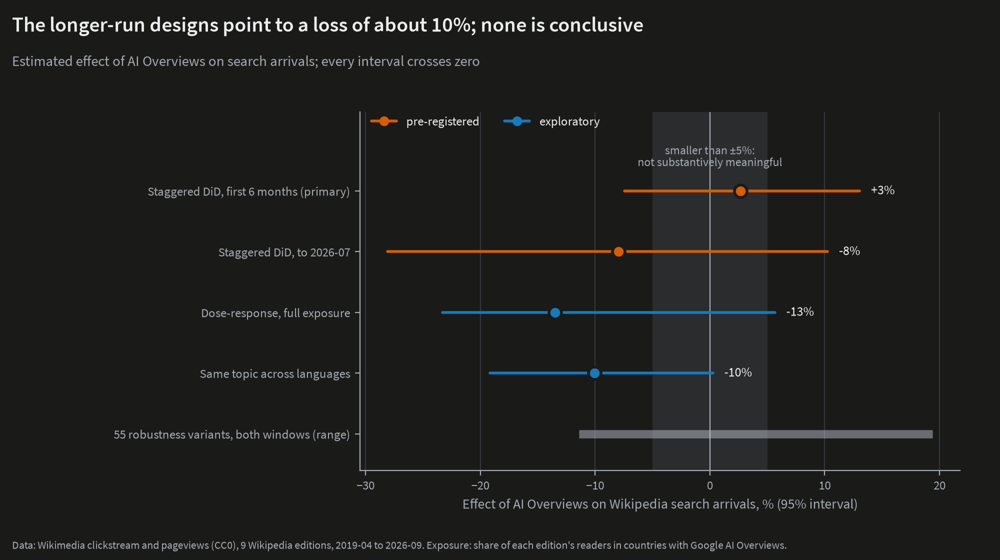{.dark-content fig-alt="Five estimates of the effect of AI Overviews on Wikipedia search arrivals with 95% intervals; every interval crosses zero."}
:::

## The question

In October 2025 the Wikimedia Foundation reported that human pageviews were down about 8% on the same months a year earlier, once it had reclassified a wave of bot traffic that had been counted as human. It named generative AI in search engines, and social video, as likely causes [@miller2025]. Browsing data from a panel of US adults point the same way. Pew Research found that Google users clicked a traditional result on 8% of visits that showed an AI summary, against 15% of visits that didn't [@pew2025].

A falling line doesn't show what caused it, though. Wikipedia traffic has many reasons to move: chatbots, social video, changes in how Google ranks pages, Wikipedia's own interface, and changes in how bots are counted. This analysis asks a narrower question that the data can answer:

1. **When Google's AI Overviews reached a language edition's readers, did search traffic to that edition fall *more* than in editions that didn't have it yet?**
2. **Which pages and readers lost the most**: pages whose answer fits in a sentence, mobile readers, rarely read articles?
3. **Did readers who still arrived from search behave differently**, and did editors leave?

## How the comparison works

**AI Overviews didn't launch everywhere at once.** Google launched AI Overviews in the US in May 2024 and then added countries and languages in waves through 2025. France got it only in July 2026, and Russia (where Yandex dominates search) never did. A language edition's readers live in many countries, so I built an **exposure** measure for each edition and month. Exposure is the share of the edition's readers who were in a country where AI Overviews was live, weighted by Google's share of search in that country. Country shares and Google shares are fixed at their values from before the launch, so the measure can't respond to the traffic it is meant to explain.

When exposure first reaches one half, the edition counts as treated:

| Treated from | Editions |
|---|---|
| September 2024 | English, Japanese, Portuguese |
| November 2024 | Spanish |
| April 2025 | German, Italian, Polish |
| June 2025 | Chinese |
| `{python} N["fr_cohort"]` | French (the comparison edition until then) |
| never | Russian (maximum exposure `{python} N["ru_max"]`) and Persian; used only as checks |

: Editions and the month AI Overviews reached at least half of their readers. {tbl-colwidths="[30,70]"}

**The outcome is search arrivals:** monthly visits to each edition that came from a search engine, from Wikimedia's public clickstream data. Clickstream covers desktop and mobile web, not the apps. It can't tell Google from Bing or Yandex, so "search" means every search engine.

**The estimate is a staggered difference-in-differences** [@callaway2021]. Each edition is compared with itself before AI Overviews arrived, and that change is compared with the change in editions that didn't have it yet. Each edition's own seasonal pattern is removed first. With only nine editions, ordinary standard errors are unreliable. The p-values and intervals therefore come from **randomization inference**: re-running the analysis with the launch dates shuffled across editions in every possible way, and asking how unusual the real result is among them.

**Before looking at any post-launch comparison, I wrote down the hypotheses, the methods, the decision rules and the smallest effect that would matter (5%), and locked them** ([pre-registration](https://github.com/johnpospisil/wikipedia-ai-overviews/blob/main/PREREGISTRATION.md)). Every later change is logged there with its date and whether it came before or after seeing results. Power simulations on pre-launch data showed the design can reliably detect a loss of about `{python} N["mde_primary"]` in the first six months and about `{python} N["mde_full"]` over the full window.

## The headline: no measurable loss

| Estimate | Effect on search arrivals | 95% interval | p |
|---|---|---|---|
| **First six months (primary, pre-registered)** | **`{python} N["att_primary_1"]`** | `{python} N["att_primary_ci"]` | `{python} N["att_primary_p"]` |
| To July 2026 (pre-registered) | `{python} N["att_full_1"]` | `{python} N["att_full_ci"]` | `{python} N["att_full_p"]` |

: Staggered difference-in-differences, nine editions. Intervals and p-values from randomization inference. {tbl-colwidths="[40,22,24,14]"}

By the pre-registered rule, the result is **inconclusive**. Neither estimate is distinguishable from zero, and neither rules out a loss of 5–10%.

::: {.column-page-inset-right}
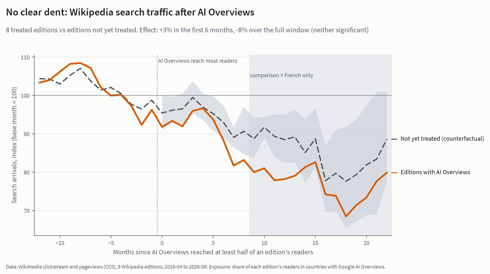{.light-content fig-alt="Event-study line chart. Search arrivals indexed to the month before AI Overviews reached an edition. Treated editions and the not-yet-treated counterfactual move together before the launch. After it, both fall, with the treated line below the counterfactual by up to about 10 points after a year. The confidence band is wide and covers the counterfactual, and from about month 9 the comparison rests on French alone (shaded)."}
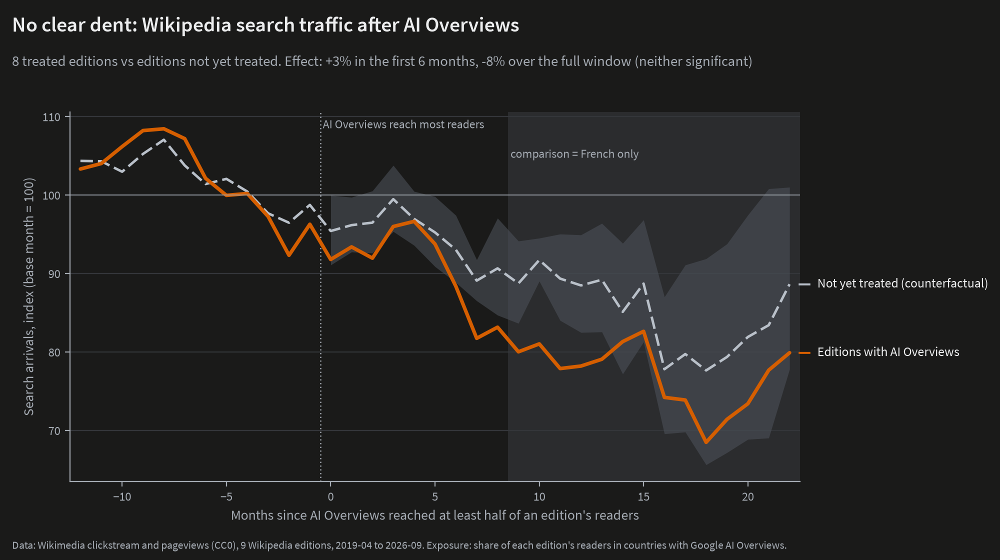{.dark-content fig-alt="Event-study chart of treated vs not-yet-treated editions around the AI Overviews launch; the gap after a year rests on French alone."}
:::

Three things qualify the headline, and the honest reading needs all of them.

**1. The first six months are probably biased upward.** In 2023, English, Spanish and Portuguese search traffic grew faster than the other editions' did. A pre-registered placebo check, which pretends AI Overviews launched 12 months earlier than it did, finds an "effect" of `{python} N["placebo_primary"]` (p = `{python} N["placebo_primary_p"]`). If that bias carried into the real launch, the true six-month effect would be about 6 points below `{python} N["att_primary_1"]`, close to the 5% threshold. The test of pre-launch trends did not flag (p = `{python} N["pretrend_p"]`), but it has little power with nine editions.

**2. The estimators don't agree on the sign.** The pre-registration requires saying so next to the headline. Sun–Abraham gives `{python} N["sa_primary"]` [@sun2021], but Borusyak–Jaravel–Spiess imputation gives `{python} N["bjs_primary"]` for the first six months and `{python} N["bjs_full"]` for the full window [@borusyak2024]. The pre-registered dose–response model gives `{python} N["dose_prereg"]`, the within-topic design (below) gives `{python} N["concept_prereg"]`, and the English time series gives `{python} N["its_prereg"]`.

**3. The full-window `{python} N["att_full"]` is really "the treated editions against French", and it is an upper bound.** After June 2025 every other edition was treated, so the comparison rests on French alone. Leaving French out moves the estimate to `{python} N["no_fr_full"]`. German, Italian and Polish were also treated in April 2025, the month Wikimedia's new bot detection began removing traffic it had counted as human. That change moved different amounts of traffic in different editions, and in those three editions it can't be separated from AI Overviews. Taking the break out of the other editions gives `{python} N["bot_step_full"]` (`{python} N["bot_step_full_ci"]`).

### Designs that use the dose

Two exploratory designs (they use different data, but they share the full window's weaknesses) point the same way as the full window:

- **Dose–response.** Treating exposure as a continuous dose, and keeping the nine editions of the main analysis, a move from no exposure to full exposure goes with `{python} N["dose_9"]` (`{python} N["dose_9_ci"]`; randomization p = `{python} N["dose_9_ri_p"]`). With all 11 editions, as pre-registered, it is `{python} N["dose_prereg"]` (p = `{python} N["dose_prereg_p"]`). Persian distorts that version: its search traffic fell sharply from May 2025, most likely because of internet restrictions in Iran.
- **The same topic across languages.** This design follows `{python} N["n_concepts"]` topics that have an article in all 11 editions, such as the same city, scientist or film. It compares each topic's search traffic between editions with and without AI Overviews in the same month. Without Persian it gives `{python} N["concept_nofa"]` (`{python} N["concept_nofa_ci"]`). The bootstrap p of `{python} N["concept_nofa_wcb_p"]` looks close to significant, but randomization inference gives `{python} N["concept_nofa_ri_p"]`. With 10–11 editions the bootstrap is too confident.

The longer-run designs therefore lean towards a loss of around 10%. That lean comes from the same months, the same French comparison and the same bot-reclassification break, and none of the designs is conclusive.

## English, and the other study

English was the first edition with AI Overviews, but at first only partly: in May–August 2024 AI Overviews reached its US readers and almost no one else. In the staggered comparison, English alone comes out at `{python} N["en_primary"]` in the first six months and `{python} N["en_full"]` over the full window. These are exploratory, edition-by-edition numbers.

**This agrees with the closest earlier study.** Khosravi and Yoganarasimhan compare the same articles in English, German and French clickstream from December 2023 to December 2024. They estimate that AI Overviews cut English search referrals by 5.45% relative to German and 4.82% relative to French [@khosravi2026]. That is the same order as the English estimate here. It is below this design's detection threshold for the pooled estimate, which explains why the pooled result can't confirm it.

**A time series of English alone can't settle it.** The pre-registered interrupted time series gives a gap of `{python} N["its_prereg"]` against the counterfactual. That number extends the 2023 surge in English search traffic forward and isn't credible. Fitting a single pre-launch trend instead gives `{python} N["its_single"]` (`{python} N["its_single_ci"]`). A one-year holdout before the launch missed by `{python} N["its_holdout"]`, so without other editions as controls, English's own history can't pin down what would have happened.

## Search fell almost everywhere

::: {.column-page-inset-right}
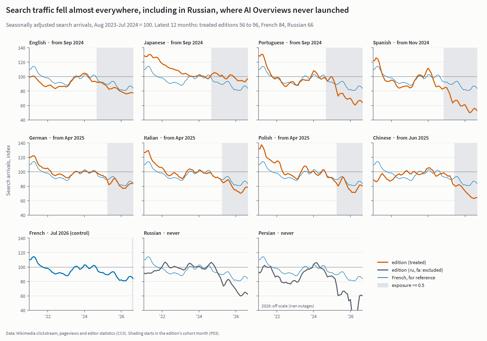{.light-content fig-alt="Small multiples of seasonally adjusted search arrivals for 11 Wikipedia editions, 2021 to 2026, indexed to August 2023–July 2024 = 100, with French as a thin reference line in every panel. Most editions end between 56 and 96. Spanish falls furthest among the treated editions (about 56), Japanese least (about 96), French ends at 84, and Russian, which never had AI Overviews, at 66."}
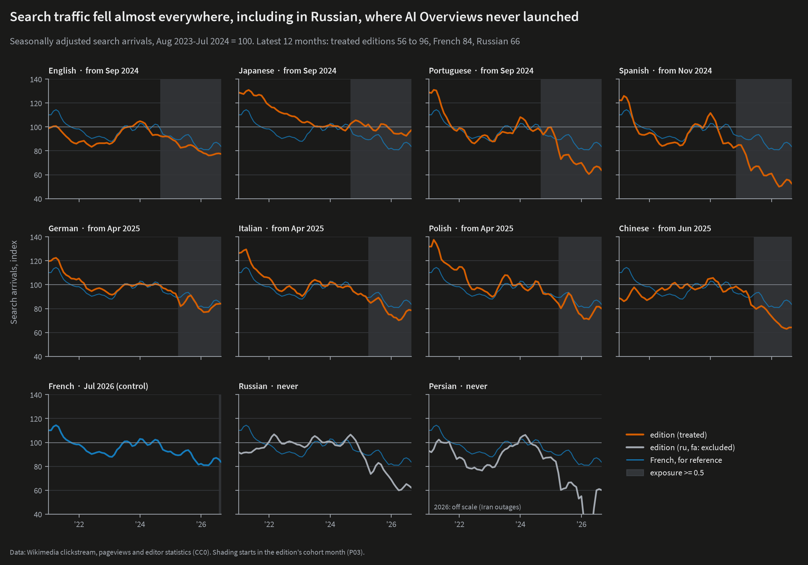{.dark-content fig-alt="Small multiples of search arrivals by edition, 2021–2026; most editions fall, including Russian, which never had AI Overviews."}
:::

Indexed to the year before AI Overviews (August 2023–July 2024 = 100), seasonally adjusted search arrivals in the latest 12 months were:

- English `{python} N["idx_en"]`, German `{python} N["idx_de"]`, Chinese `{python} N["idx_zh"]`, Portuguese `{python} N["idx_pt"]`, Spanish `{python} N["idx_es"]`, Japanese `{python} N["idx_ja"]`
- French `{python} N["idx_fr"]`
- Russian `{python} N["idx_ru"]` (never had AI Overviews)

**These levels are not effects.** Most of the largest falls are in *all* traffic, not search alone:

- **Spanish:** all views `{python} N["views_chg_es"]` over the same period, and search's share of arrivals moved only from `{python} N["sshare_before_es"]` to `{python} N["sshare_latest_es"]`.
- **Portuguese:** views `{python} N["views_chg_pt"]`; search share `{python} N["sshare_before_pt"]` → `{python} N["sshare_latest_pt"]`.
- **Russian:** views `{python} N["views_chg_ru"]`; search share `{python} N["sshare_before_ru"]` → `{python} N["sshare_latest_ru"]`.

A fall shared by every way of arriving at Wikipedia isn't specific to search. Spanish and Portuguese drop most steeply in early 2025, the window in which Wikimedia reclassified a wave of evasive bots, mostly from Brazil [@miller2025]. The new filter was not applied to earlier months, so the base period still includes some traffic the Foundation would now call automated. The rest of the decline is shared across editions with and without AI Overviews, which is what the difference-in-differences design subtracts out.

**How much of the decline is AI Overviews?** Since the 12 months before ChatGPT, search arrivals fell `{python} N["total_en_abs"]` in English and `{python} N["total_pooled_abs"]` across the eight treated editions together. The full-window estimate would put `{python} N["aio_share"]` of the pooled decline down to AI Overviews. But its 95% range runs from `{python} N["aio_share_range"]`, which is no information at all, and the full-window caveats above apply.

**Chatbots don't show up in the data.** ChatGPT and Perplexity referrals land in clickstream's "other websites" bucket, which can't be split by source. That bucket fell from `{python} N["ext_before"]` of English arrivals in the year before ChatGPT to `{python} N["ext_latest"]` in the latest 12 months. Chatbots that send readers on to Wikipedia aren't sending many. That says nothing about how many people now read a chatbot's answer *instead of* Wikipedia.

## Which pages and readers?

Each of the following was a pre-registered secondary hypothesis. Their p-values were corrected together with Holm's method [@holm1979]. **None survives:** the smallest uncorrected p-value is `{python} N["holm_min_p"]`.

### Quick-answer pages

The obvious prediction is that AI Overviews hurt pages whose typical question has a one-line answer most, such as a capital, a birth date or a film's release year. Each article got a quick-answer score from Natural Questions [@kwiatkowski2019], a public set of real Google queries answered from Wikipedia, using the share of queries about that kind of article (by Wikidata type) that have a short answer.

::: {.column-page-inset-right}
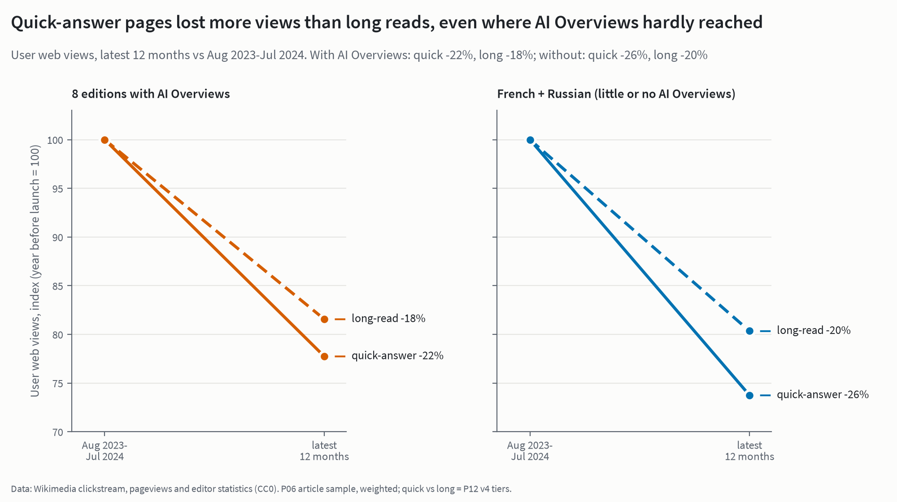{.light-content fig-alt="Slope chart of user web views, the year before AI Overviews vs the latest 12 months. In the eight editions with AI Overviews, quick-answer pages fell 22% and long reads 18%. In French and Russian, where AI Overviews hardly reached, quick-answer pages fell 26% and long reads 20%."}
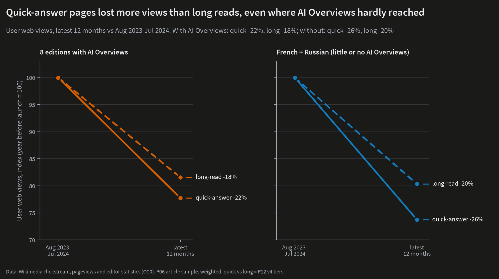{.dark-content fig-alt="Slope chart: quick-answer pages fell more than long reads both with and without AI Overviews."}
:::

Quick-answer pages did lose more views than long reads: `{python} N["quick_exposed"]` against `{python} N["long_exposed"]` in the editions with AI Overviews. But they also lost more where AI Overviews hardly reached: `{python} N["quick_ctrl"]` against `{python} N["long_ctrl"]` in French and Russian. The pre-registered test, which asks whether quick-answer pages lose more *as exposure rises*, gives `{python} N["h2"]` per standard deviation of the score at full exposure (`{python} N["h2_ci"]`, p = `{python} N["h2_p"]`). That is a tight null.

::: {.column-page-inset-right}
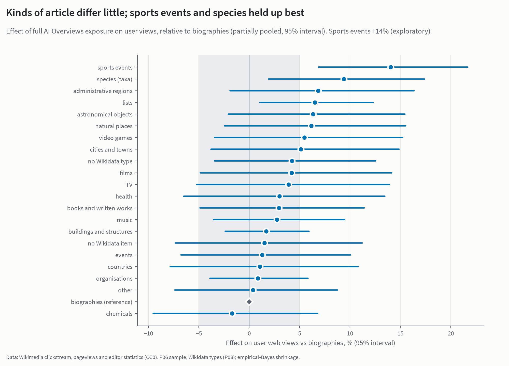{.light-content fig-alt="Dot plot of the exploratory effect of full AI Overviews exposure on views by kind of article, relative to biographies, with partially pooled estimates. Most kinds lie within a few percent of biographies; sports events (+14%) and species hold up best."}
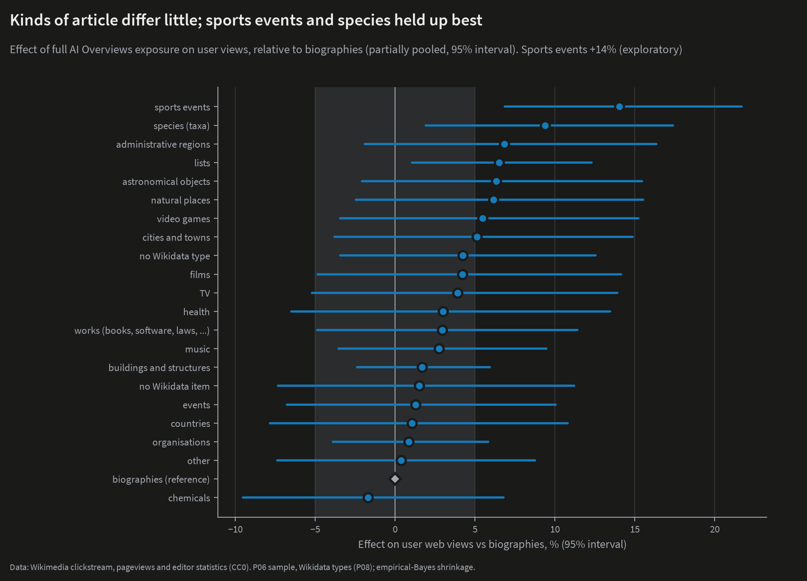{.dark-content fig-alt="Effects by kind of article relative to biographies; most kinds differ little."}
:::

Splitting articles into `{python} N["n_types"]` kinds (biographies, settlements, species, films and so on) and pooling the small groups shows little difference. Only sports events stand out, holding up `{python} N["sports_events"]` better than biographies. That is an exploratory result.

### Mobile vs desktop, head vs tail

- **Mobile web vs desktop** (pageviews, first six months): `{python} N["h3_primary"]`. Over the full window the gap is `{python} N["h3_full"]`. That window is not the pre-registered test, it falls in the bot-reclassification period, and it rests on French. It should not be read as an AI Overviews effect.
- **Rarely read vs popular articles** (by 2023 popularity): if anything the long tail did better, by `{python} N["h4_abs"]` at full exposure relative to the most-read articles (`{python} N["h4_ci"]`, p = `{python} N["h4_p"]`). The test uses pageviews, because clickstream drops any page–referrer pair with fewer than 10 visits a month. That threshold makes long-tail declines look much larger than they are. Search arrivals corrected for it give `{python} N["h4_corr"]` (p = `{python} N["h4_corr_p"]`).

## Do readers still arrive and click through?

::: {.column-page-inset-right}
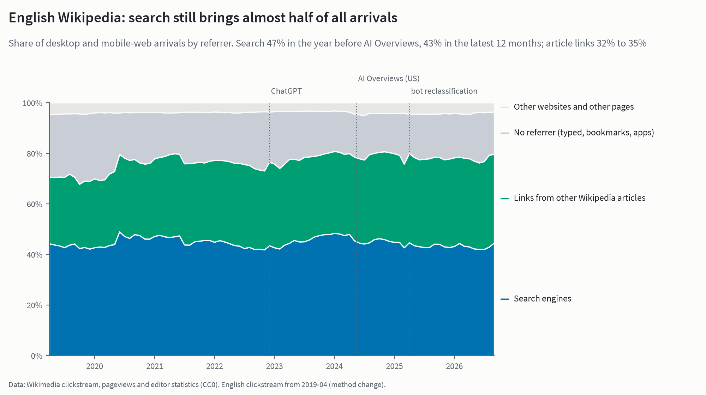{.light-content fig-alt="Stacked-area chart of English Wikipedia arrivals by referrer, 2019 to 2026: search, links from other Wikipedia articles, no referrer, and other websites. Search is about 47% of arrivals in the year before AI Overviews and 43% in the latest 12 months; article links rise from 32% to 35%."}
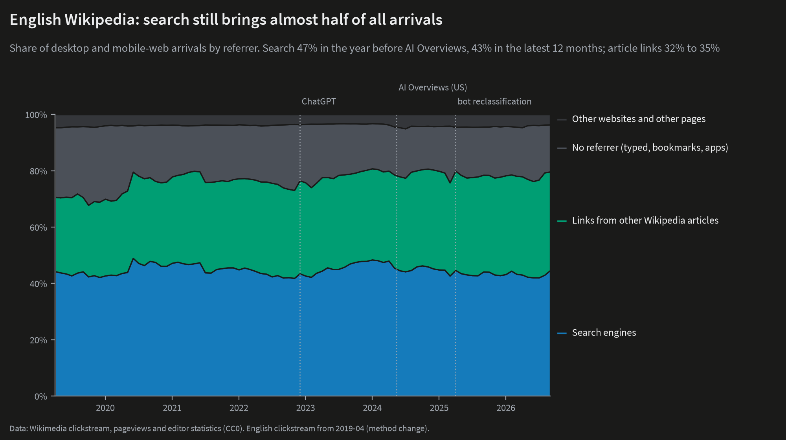{.dark-content fig-alt="English Wikipedia arrivals by referrer; search falls from 47% to 43% of arrivals."}
:::

Search brought `{python} N["en_search_before"]` of English Wikipedia's arrivals in the year before AI Overviews and `{python} N["en_search_latest"]` in the latest 12 months. Clicks from one article to another rose from `{python} N["en_links_before"]` to `{python} N["en_links_latest"]`. Across the eight treated editions, search fell from `{python} N["mix_tr_search_before"]` to `{python} N["mix_tr_search_latest"]` of arrivals, while French went from `{python} N["mix_fr_search_before"]` to `{python} N["mix_fr_search_latest"]`.

Those are descriptive shares. The pre-registered tests find no AI Overviews effect on either:

- **Search's share of arrivals:** `{python} N["h5a"]`.
- **How far readers go:** clicks to other articles per arrival from outside Wikipedia, `{python} N["h5b"]`.

One idea was that AI Overviews filters out casual searchers, so that the readers who still click through are the more engaged ones. Article-level depth gives no sign of that either.

## Editors

::: {.column-page-inset-right}
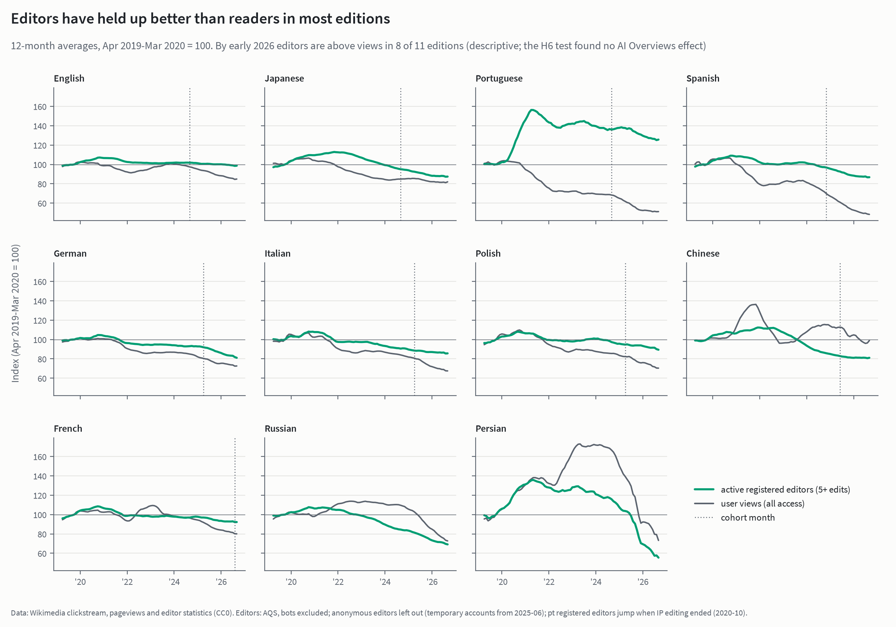{.light-content fig-alt="Small multiples for 11 editions of 12-month averages of active registered editors and pageviews, April 2019–March 2020 = 100. In most editions editors fall more slowly than views; by early 2026 editors are above views in 8 of 11 editions."}
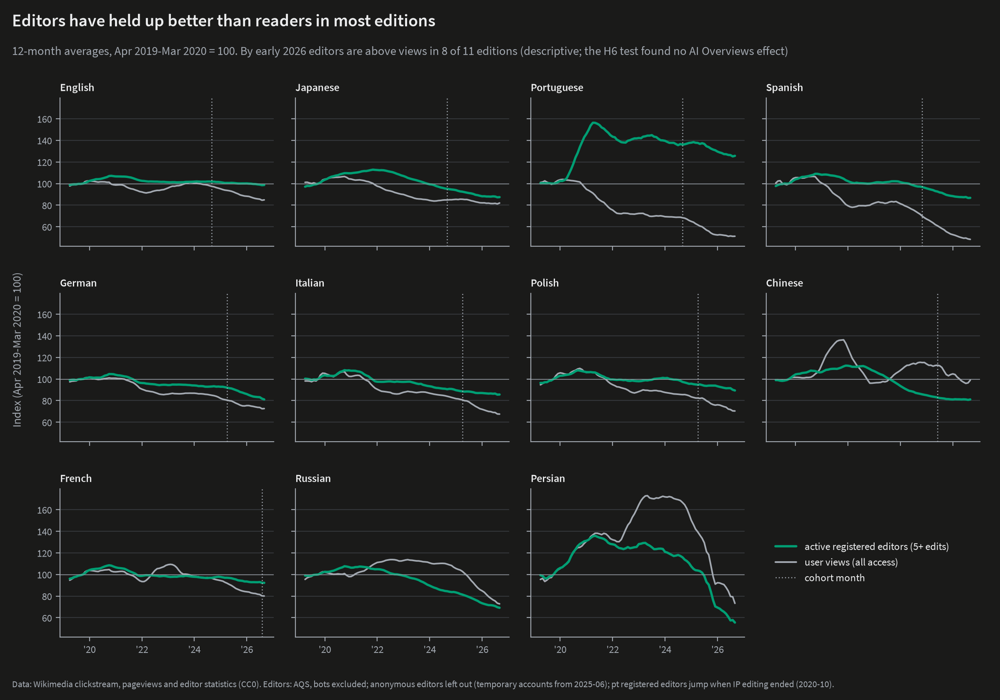{.dark-content fig-alt="Active editors vs views by edition; editors held up better than views in most editions."}
:::

If fewer readers arrive, fewer of them might become editors. By early 2026, active registered editors had held up better than views in `{python} N["editors_above"]` of 11 editions. The pre-registered test (registered editors 6 to 18 months after launch) gives `{python} N["h6"]`. Even a large fall in editors would have been hard to detect with these data, so this null says little either way.

## What this doesn't show

- **Lost clicks are not harmed readers.** Someone who gets a correct answer from an AI summary may be no worse off. The harm, if any, is to Wikipedia: fewer visits mean fewer readers who might donate, edit or follow a citation. This analysis measures visits, not what readers learned.
- **It doesn't say AI Overviews had no effect.** It says the effect is too small to separate from zero with nine editions and two years of data. A loss of about 5%, as estimated for English elsewhere [@khosravi2026], fits these results.
- **It doesn't measure chatbots.** ChatGPT and similar tools arrived everywhere at about the same time, so a comparison across editions can't isolate them. Their effect is part of the decline common to all editions.
- **It covers the web only, not the apps**, and "search" means all search engines, not just Google.
- **The clickstream threshold** (pairs with fewer than 10 visits a month are dropped) hides `{python} N["trunc_range"]` of each edition's search arrivals. It makes article-level clickstream unusable for rarely read pages, which is why those results use pageviews.

## Robustness

::: {.column-page-inset-right}
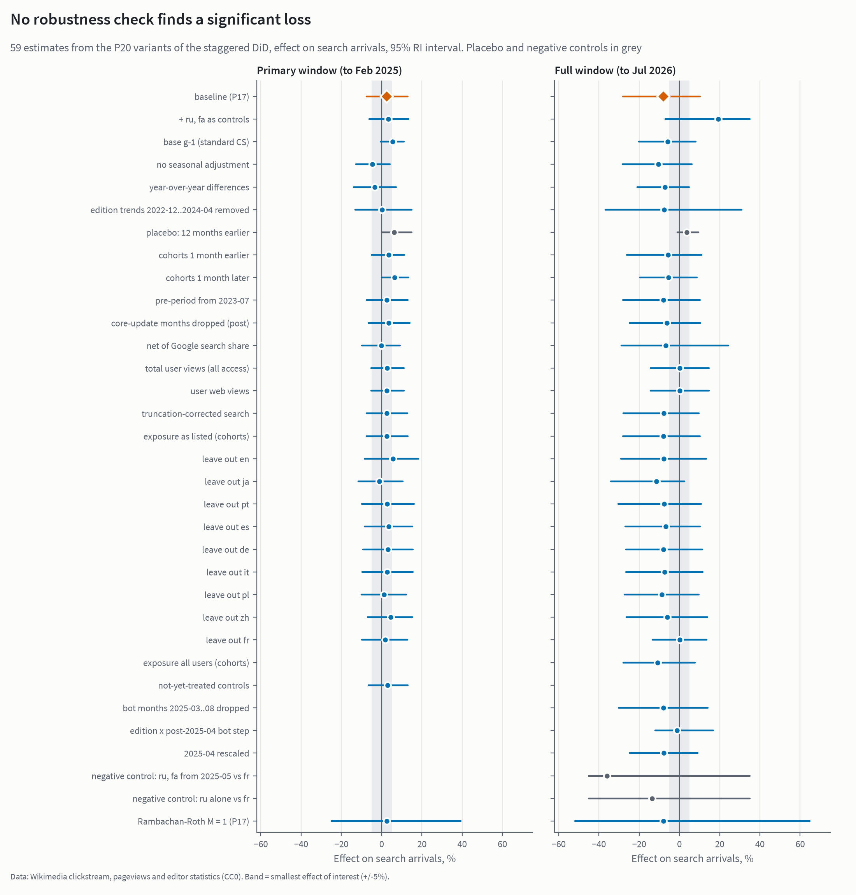{.light-content fig-alt="Forest plot of every pre-registered robustness variant of the staggered difference-in-differences, in two panels (first six months and full window), each with a 95% randomization-inference interval and a ±5% band. No variant shows a significant loss; placebo and negative-control rows are in grey."}
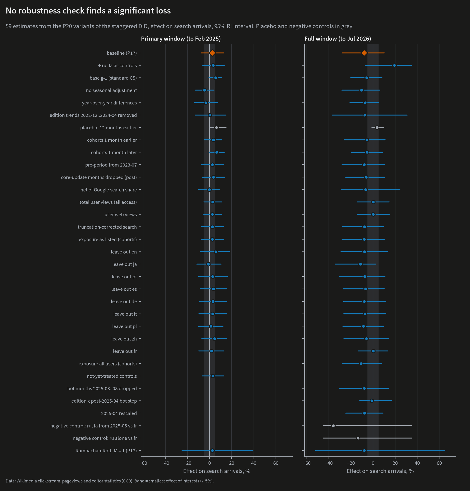{.dark-content fig-alt="Forest plot of robustness variants; none shows a significant loss."}
:::

`{python} N["n_variants"]` pre-registered variants were run across both windows. Point estimates range from `{python} N["rob_min"]` to `{python} N["rob_max"]`, and `{python} N["n_sig_loss"]` show a statistically significant loss. The variants cover:

- launch dates shifted by a month either way
- dropping the ChatGPT launch months
- leaving out each edition in turn
- dropping Google core-update months: `{python} N["core_primary"]` and `{python} N["core_full"]`
- a bot-reclassification break per edition
- controlling for Google's search share
- total pageviews instead of clickstream
- a truncation-corrected outcome
- adding Russian and Persian as controls

The negative control, which treats Russian as if it had AI Overviews and compares it with French, gives `{python} N["ru_vs_fr"]`. That is far more than Russian's small dose would predict, one more sign that French drifted upward on its own.

## Scorecard against the pre-registration

| | Hypothesis | Result |
|---|---|---|
| **H1** (primary) | Search arrivals fall when AI Overviews arrives | **Inconclusive.** `{python} N["att_primary_1"]` (`{python} N["att_primary_ci"]`) in the first six months, `{python} N["att_full_1"]` (`{python} N["att_full_ci"]`) to July 2026 |
| H2 | Quick-answer pages lose more | **Not supported.** `{python} N["h2"]` per SD (`{python} N["h2_ci"]`) |
| H3 | Mobile loses more than desktop | **Not supported** in the pre-registered window |
| H4 | The long tail loses more than popular pages | **Not supported.** The tail lost less, if anything |
| H5a | Search's share of arrivals falls | **Not supported** |
| H5b | Readers go deeper or shallower | **Not supported** |
| H6 | Active registered editors fall | **Not supported** (low power) |

: Pre-registered hypotheses. H2–H6 are corrected together with Holm's method; `{python} N["holm_supported"]` survive. {tbl-colwidths="[10,40,50]"}

## How this fits with other work

- **Wikimedia Foundation:** human pageviews about 8% below a year earlier in 2025, after reclassifying bot traffic, with AI search named as one cause [@miller2025]. This analysis finds the same broad decline, but most of it is shared by editions with and without AI Overviews.
- **Khosravi and Yoganarasimhan:** about 5% fewer English search referrals because of AI Overviews, against German and French [@khosravi2026]. That is consistent with the English estimate here, and below what this design can detect when the editions are pooled.
- **ChatGPT and Wikipedia:** Reeves, Yin and Simperl found no significant drop in Wikipedia use after ChatGPT, comparing languages where it was and wasn't available [@reeves2024]. Lyu and colleagues found that English articles most similar to ChatGPT's answers lost more views and edits [@lyu2025].
- **Stack Overflow:** the [sister project](https://johnpospisil.github.io/stackoverflow-decline/) found that new Stack Overflow questions fell far below what comparable sites predict after ChatGPT. That result was larger and clearer than anything here. Stack Overflow's questions are the kind a chatbot answers directly, while Wikipedia's readers come mostly through search and still arrive in large numbers.

## Methods appendix

**Data.** Wikimedia clickstream (monthly, 2019-04 to 2026-09; earlier months use a different method), pageviews (`pageview_complete`, daily, `user` agent), AQS editor counts, pageviews by country (for exposure), StatCounter search-engine shares, and Google's own record of where AI Overviews launched (dated from archived copies of its help page and official announcements). All Wikimedia data are CC0. The article panel is a stratified sample of `{python} N["n_sample"]` articles, drawn on 2023 popularity so that it isn't selected on the outcome. Data provenance is in [DATA.md](https://github.com/johnpospisil/wikipedia-ai-overviews/blob/main/DATA.md).

**Outcome.** Log monthly search arrivals per edition, with each edition's month-of-year pattern (estimated on pre-launch data) removed. April 2025's clickstream file is about five days short and is set to missing.

**Estimators.** Callaway–Sant'Anna group-time effects with not-yet-treated controls, with the base month set to the month before first exposure [@callaway2021]. Cross-checks: Sun–Abraham [@sun2021] and Borusyak–Jaravel–Spiess imputation [@borusyak2024]. Pre-trend bounds use Rambachan–Roth relative magnitudes [@rambachan2023]. Dose–response: two-way fixed effects on continuous exposure. Within-topic: topic × month and topic × edition fixed effects. Article-level tests (H2, H4): article and edition × month fixed effects, with wild cluster bootstrap by edition.

**Inference.** Exact randomization inference over all `{python} N["n_assign"]` assignments of the nine editions' launch dates, with intervals by test inversion under a constant effect. The bootstrap is reported but doesn't decide. With nine editions it overstates precision badly: its standard error for the full window would make `{python} N["att_full"]` look significant, while randomization inference gives p = `{python} N["att_full_p"]`.

**Validation and deviations.** An independent review of identification, leakage, inference and every claim is in [validation.md](https://github.com/johnpospisil/wikipedia-ai-overviews/blob/main/report/validation.md). Every change to the pre-registered plan is in the [deviations log](https://github.com/johnpospisil/wikipedia-ai-overviews/blob/main/PREREGISTRATION.md#11-deviations).

**Reproducing.** `make models figures` rebuilds every estimate and chart from the processed data in about an hour. `make all SAMPLE=1` runs the whole pipeline on a synthetic dump with a known planted effect in under two minutes, and CI checks that it recovers that effect. Every number in this article is read from the pipeline's output files, not typed by hand. The exceptions are results from other studies, which are cited.

**Licence and attribution.** Wikimedia pageview, clickstream and editor data are CC0. This analysis publishes derived counts only, never article text. It is independent and not affiliated with or endorsed by the Wikimedia Foundation or Google.

## References

::: {#refs}
:::
